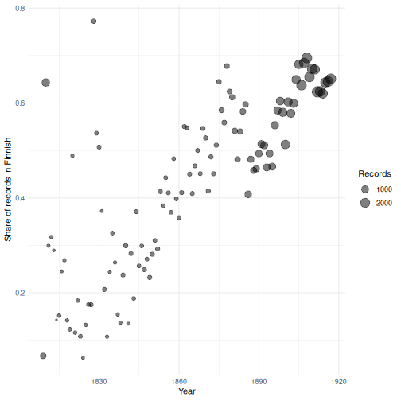
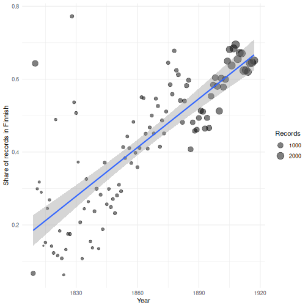

:::::::::::::::::::::::::::::::::::::: questions

- How fast did the share of Finnish-language publishing grow?
- How do we describe a trend with a linear regression?
- How do data decisions affect the estimated trend?

::::::::::::::::::::::::::::::::::::::::::::::::

::::::::::::::::::::::::::::::::::::: objectives

- Summarise the data into a yearly share before modelling.
- Fit a simple linear regression with `lm()` and interpret the slope and R-squared.
- Plot the data together with the fitted model and judge whether a straight line is a good description.
- Compare the trend estimated from different subsets of the data.

::::::::::::::::::::::::::::::::::::::::::::::::


## Part 4: Basic statistical analysis

The data is now ready for analysis. In this part of the course we answer
three research questions that are steps towards the running question,
*how did the shift from Swedish to Finnish in publishing happen?* Each
question is answered with one basic statistical method.

**Research question 1:** *How fast did the share of Finnish-language
publications grow during the 19th century?*

## Getting started

The analysis episodes use `fennica_clean`, a version of the project's
harmonised data with a publication year, decade, language, place, publisher
and genre for each record. Create it with the script
[`clean_fennica.R`](files/clean_fennica.R), and save it once:


``` r
source("clean_fennica.R")
write_ipc_file(fennica_clean, "data/fennica_clean.feather")
```

In a new R session you then only need:


``` r
library(arrow)
library(dplyr)
library(ggplot2)
fennica_clean <- read_ipc_file("data/fennica_clean.feather")
```

## From records to a yearly share

A regression needs one row per observation. Our question is about years,
so we first **summarise** the records into one row per year: the number of
records, and the share of them in Finnish.


``` r
finnish_share <- fennica_clean |>
  filter(!is.na(year), !is.na(language)) |>
  group_by(year) |>
  summarise(n = n(), share_finnish = mean(language == "Finnish"))

head(finnish_share)
```

``` output
# A tibble: 6 × 3
   year     n share_finnish
  <dbl> <int>         <dbl>
1  1809   581        0.0671
2  1810  1253        0.643 
3  1811   107        0.299 
4  1812   107        0.318 
5  1813    76        0.289 
6  1814    49        0.143 
```

`mean()` of a logical vector is the share of `TRUE` values. Always look at
the data before you model it:


``` r
ggplot(finnish_share, aes(x = year, y = share_finnish)) +
  geom_point(aes(size = n), alpha = 0.5) +
  labs(x = "Year", y = "Share of records in Finnish", size = "Records") +
  theme_minimal()
```



## Simple linear regression

**Linear regression** describes how one variable changes with another by
fitting a straight line:


``` r
model <- lm(share_finnish ~ year, data = finnish_share)
summary(model)
```

``` output

Call:
lm(formula = share_finnish ~ year, data = finnish_share)

Residuals:
     Min       1Q   Median       3Q      Max 
-0.19252 -0.07828 -0.01579  0.04805  0.50276 

Coefficients:
              Estimate Std. Error t value Pr(>|t|)    
(Intercept) -7.8838925  0.6356276  -12.40   <2e-16 ***
year         0.0044604  0.0003411   13.07   <2e-16 ***
---
Signif. codes:  0 '***' 0.001 '**' 0.01 '*' 0.05 '.' 0.1 ' ' 1

Residual standard error: 0.1121 on 107 degrees of freedom
Multiple R-squared:  0.615,	Adjusted R-squared:  0.6115 
F-statistic:   171 on 1 and 107 DF,  p-value: < 2.2e-16
```

The formula `share_finnish ~ year` reads "share of Finnish *explained by*
year". The most important numbers are:

- The `year` estimate, the **slope**: on average, the share of Finnish grew
  by about 0.45 percentage points per
  year, or about 4.5 percentage points
  per decade.
- `R-squared`: how much of the variation in the yearly share the line
  explains, from 0 (none) to 1 (all).

We draw the fitted line with `geom_smooth(method = "lm")`:

Before modelling, notice the few years far above their neighbours, such as
1810 and 1828. A spike like this is often a data question rather than a
historical event (for example a large group of records with an uncertain
date); we come back to dates later in the course.


``` r
ggplot(finnish_share, aes(x = year, y = share_finnish)) +
  geom_point(aes(size = n), alpha = 0.5) +
  geom_smooth(method = "lm") +
  labs(x = "Year", y = "Share of records in Finnish", size = "Records") +
  theme_minimal()
```



::::::::::::::::::::::::::::::::::::: callout

### Check your model

Always plot your data together with the model. A straight line is a strong
simplification: here, the share hardly changes in the first decades and
grows later, and years with few records (small points) vary a lot. A share also cannot go
below 0 or above 1, but a line can. Models for shares, such as **logistic
regression**, come later in the course. A model is a summary, not the truth.

::::::::::::::::::::::::::::::::::::::::::::::::

::::::::::::::::::::::::::::::::::::: challenge

## Challenge 1: Two periods

Fit the same model separately for the years before 1850 and from 1850
onwards. Compare the two slopes with the slope for the whole period. What do
they tell you about the shape of the trend?

:::::::::::::::::::::::: solution


``` r
model_early <- lm(share_finnish ~ year, data = filter(finnish_share, year < 1850))
model_late <- lm(share_finnish ~ year, data = filter(finnish_share, year >= 1850))
coef(model)["year"]
```

``` output
       year 
0.004460376 
```

``` r
coef(model_early)["year"]
```

``` output
        year 
3.779151e-05 
```

``` r
coef(model_late)["year"]
```

``` output
       year 
0.004063222 
```

Before 1850 the slope is almost zero: the share of Finnish stayed at roughly
the same level, with large jumps from year to year. From 1850 onwards it
grew by about 0.41 percentage points
per year. The shift was not a steady process over the whole century: it
started around the middle of the century. One straight line for the whole
period hides this.

:::::::::::::::::::::::::::::::::
::::::::::::::::::::::::::::::::::::::::::::::::

::::::::::::::::::::::::::::::::::::: challenge

## Challenge 2: Does the data decision matter?

In the validation episode we saw that the publisher is missing much more
often for Swedish than for Finnish records. Calculate the yearly share again
using **only records with a known publisher**, fit the model, and compare
the slope and the fitted values with the model for all records.

:::::::::::::::::::::::: solution


``` r
share_known_publisher <- fennica_clean |>
  filter(!is.na(year), !is.na(language), !is.na(publisher)) |>
  group_by(year) |>
  summarise(n = n(), share_finnish = mean(language == "Finnish"))

model_publisher <- lm(share_finnish ~ year, data = share_known_publisher)
coef(model)
```

``` output
 (Intercept)         year 
-7.883892478  0.004460376 
```

``` r
coef(model_publisher)
```

``` output
(Intercept)        year 
-13.1337622   0.0072916 
```

``` r
new_years <- data.frame(year = c(1850, 1910))
predict(model, new_years)
```

``` output
        1         2 
0.3678025 0.6354250 
```

``` r
predict(model_publisher, new_years)
```

``` output
        1         2 
0.3556983 0.7931943 
```

With a known publisher, the slope is steeper: about
0.73 instead of
0.45 percentage points per year, and the
predicted share of Finnish in 1910 is
79% instead
of 64%. Leaving out
the records without a publisher, which are more often Swedish, makes the
shift look faster. The **selection** of records changes the answer. How certain we can be about such results is the topic
of the probabilistic part of the course.

:::::::::::::::::::::::::::::::::
::::::::::::::::::::::::::::::::::::::::::::::::

::::::::::::::::::::::::::::::::::::: keypoints

- Summarise the records to the level of your question (here: one row per year) before modelling.
- `lm(y ~ x)` fits a linear regression; the slope tells how much y changes per unit of x.
- Plot the data together with the model; a straight line is often too simple.
- The estimated trend depends on which records are included.

::::::::::::::::::::::::::::::::::::::::::::::::
