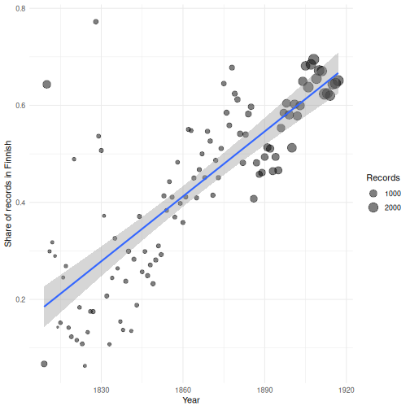
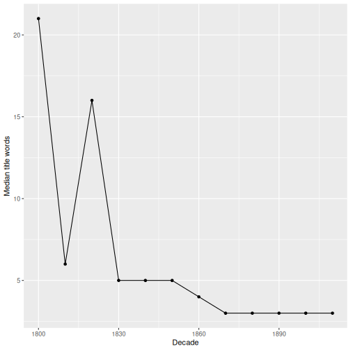

:::::::::::::::::::::::::::::::::::::: questions

- How do I describe a numeric variable with summary statistics?
- How do I measure whether two variables are related?
- How do I test whether groups differ, and how should I interpret the result?

::::::::::::::::::::::::::::::::::::::::::::::::

::::::::::::::::::::::::::::::::::::: objectives

- Calculate and interpret the mean, median, standard deviation and quantiles.
- Measure association with a correlation coefficient.
- Compare two groups with a t-test and a Wilcoxon test.
- Test the association between two categorical variables with a chi-squared test.
- Fit and interpret a simple linear regression.
- Explain why effect size matters more than p-values in large datasets.

::::::::::::::::::::::::::::::::::::::::::::::::


## Getting started

Load the packages and the clean data as in the previous episodes:

```r
library(arrow)
library(dplyr)
library(ggplot2)
fennica_clean <- read_ipc_file("data/fennica_clean.feather")
```

Our running question in this episode: **did titles get shorter during the
19th century?** Early modern books often had very long, descriptive titles.
We will use the number of words in the title, `title_words`, to find out.

## Describing a variable

The **mean** is the average; the **median** is the middle value when all
values are sorted:


``` r
mean(fennica_clean$title_words)
```

``` output
[1] 6.178159
```

``` r
median(fennica_clean$title_words)
```

``` output
[1] 3
```

The mean is much larger than the median. As we saw in the histogram in the
previous episode, the distribution is **skewed**: a few very long titles pull
the mean upwards. For skewed data the median is often a better description of
a "typical" value.

The **standard deviation** describes how spread out values are around the
mean, and **quantiles** split sorted values into portions:


``` r
sd(fennica_clean$title_words)
```

``` output
[1] 9.643476
```

``` r
quantile(fennica_clean$title_words, probs = c(0.1, 0.25, 0.5, 0.75, 0.9))
```

``` output
10% 25% 50% 75% 90% 
  1   2   3   6  12 
```

Half of the titles have between
2 and
6 words (the interquartile range),
while 10% have more than 12 words.

::::::::::::::::::::::::::::::::::::: challenge

## Challenge 1: Describe by period

Compare the median, mean and 90th percentile of `title_words` for records
published **before 1850** and **from 1900 onwards**.

:::::::::::::::::::::::: solution


``` r
fennica_clean |>
  filter(year < 1850 | year >= 1900) |>
  mutate(period = if_else(year < 1850, "before 1850", "1900 onwards")) |>
  group_by(period) |>
  summarise(
    median = median(title_words),
    mean = mean(title_words),
    p90 = quantile(title_words, 0.9)
  )
```

``` output
# A tibble: 2 × 4
  period       median  mean   p90
  <chr>         <dbl> <dbl> <dbl>
1 1900 onwards      3  4.39     9
2 before 1850       6 17.2     51
```

Titles were clearly longer in the early period.

:::::::::::::::::::::::::::::::::
::::::::::::::::::::::::::::::::::::::::::::::::

## Correlation

A **correlation coefficient** measures how strongly two numeric variables are
related, on a scale from −1 (perfect negative relationship) through 0 (no
linear relationship) to +1 (perfect positive relationship).


``` r
cor(fennica_clean$year, fennica_clean$title_words, use = "complete.obs")
```

``` output
[1] -0.4095985
```

`use = "complete.obs"` skips records where either value is missing.
The negative value means that later records tend to have shorter titles.

The standard (Pearson) correlation is sensitive to extreme values.
The **Spearman** correlation uses ranks instead of values and is more robust
for skewed data:


``` r
cor(fennica_clean$year, fennica_clean$title_words,
    use = "complete.obs", method = "spearman")
```

``` output
[1] -0.1937598
```

::::::::::::::::::::::::::::::::::::: callout

### Correlation is not causation

A correlation only says that two variables vary together. Titles did not get
shorter *because* time passed: changes in printing, genres, readership and
cataloguing practice are possible explanations that we would have to
investigate.

::::::::::::::::::::::::::::::::::::::::::::::::

## Comparing two groups

Are Swedish titles longer than Finnish ones?


``` r
fi_sv <- fennica_clean |>
  filter(language %in% c("Finnish", "Swedish"))

fi_sv |>
  group_by(language) |>
  summarise(n = n(),
            mean_words = mean(title_words),
            median_words = median(title_words))
```

``` output
# A tibble: 2 × 4
  language     n mean_words median_words
  <chr>    <int>      <dbl>        <dbl>
1 Finnish  40378       3.90            3
2 Swedish  23338       7.00            4
```

Swedish titles are longer on average. But could a difference like this arise
just by chance? A **statistical test** helps us judge this.

The **t-test** compares the means of two groups:


``` r
t.test(title_words ~ language, data = fi_sv)
```

``` output

	Welch Two Sample t-test

data:  title_words by language
t = -54.597, df = 30717, p-value < 2.2e-16
alternative hypothesis: true difference in means between group Finnish and group Swedish is not equal to 0
95 percent confidence interval:
 -3.215516 -2.992640
sample estimates:
mean in group Finnish mean in group Swedish 
             3.896008              7.000086 
```

The formula `title_words ~ language` reads "title words *by* language".
The output gives the two group means, a confidence interval for their
difference and a **p-value**. The p-value is the probability of seeing a
difference at least this large *if there were really no difference* between the
groups. A small p-value (conventionally below 0.05) suggests the difference is
unlikely to be due to chance alone.

Because `title_words` is very skewed, a **Wilcoxon rank-sum test**, which
compares ranks instead of means, is a safer choice:


``` r
wilcox.test(title_words ~ language, data = fi_sv)
```

``` output

	Wilcoxon rank sum test with continuity correction

data:  title_words by language
W = 333355182, p-value < 2.2e-16
alternative hypothesis: true location shift is not equal to 0
```

::::::::::::::::::::::::::::::::::::: callout

### Big data, tiny p-values

With tens of thousands of records, even tiny and unimportant differences give
p-values close to zero. Always look at the **effect size**, i.e. how large the
difference is in real terms (here: about three words on average, one word in
the median), and ask whether it is meaningful for your research question.

Also remember that Fennica is not a random sample: it aims to cover *all*
publications. Statistical tests then tell us whether a pattern is strong
compared to random variation, not whether it holds in some larger
"population".

::::::::::::::::::::::::::::::::::::::::::::::::

## Two categorical variables: the chi-squared test

Did Finnish and Swedish publishing differ in what *kind* of books were
published? Let's compare the share of fiction and non-fiction:


``` r
fiction_table <- fi_sv |>
  filter(!is.na(genre), genre != "Other") |>
  mutate(fiction = if_else(genre == "Non-fiction", "Non-fiction", "Fiction")) |>
  select(language, fiction) |>
  table()

fiction_table
```

``` output
         fiction
language  Fiction Non-fiction
  Finnish   10235       21934
  Swedish    3767       14242
```

``` r
prop.table(fiction_table, margin = 1)
```

``` output
         fiction
language    Fiction Non-fiction
  Finnish 0.3181634   0.6818366
  Swedish 0.2091732   0.7908268
```

`prop.table(..., margin = 1)` gives proportions within each row (language).
The **chi-squared test** asks whether the two variables are independent:


``` r
chisq.test(fiction_table)
```

``` output

	Pearson's Chi-squared test with Yates' continuity correction

data:  fiction_table
X-squared = 681.18, df = 1, p-value < 2.2e-16
```

The very small p-value means the share of fiction is clearly different
between the languages. As always, look at the proportions above to see *how*
they differ.

## Simple linear regression

**Linear regression** describes how one variable changes with another by
fitting a straight line. Let's model how the share of Finnish-language
publications changed per year:


``` r
finnish_share <- fennica_clean |>
  filter(!is.na(year)) |>
  group_by(year) |>
  summarise(share_finnish = mean(language == "Finnish"), n = n())

model <- lm(share_finnish ~ year, data = finnish_share)
summary(model)
```

``` output

Call:
lm(formula = share_finnish ~ year, data = finnish_share)

Residuals:
     Min       1Q   Median       3Q      Max 
-0.19252 -0.07828 -0.01579  0.04805  0.50276 

Coefficients:
              Estimate Std. Error t value Pr(>|t|)    
(Intercept) -7.8838925  0.6356276  -12.40   <2e-16 ***
year         0.0044604  0.0003411   13.07   <2e-16 ***
---
Signif. codes:  0 '***' 0.001 '**' 0.01 '*' 0.05 '.' 0.1 ' ' 1

Residual standard error: 0.1121 on 107 degrees of freedom
Multiple R-squared:  0.615,	Adjusted R-squared:  0.6115 
F-statistic:   171 on 1 and 107 DF,  p-value: < 2.2e-16
```

The most important numbers are the **coefficients**:

- The `year` estimate is the **slope**: on average, the share of Finnish
  grew by about 0.45 percentage points per
  year.
- `R-squared` tells how much of the variation in the share is explained by the
  line, from 0 (none) to 1 (all).

We can draw the fitted line with `geom_smooth(method = "lm")`:


``` r
ggplot(finnish_share, aes(x = year, y = share_finnish)) +
  geom_point(aes(size = n), alpha = 0.5) +
  geom_smooth(method = "lm") +
  labs(x = "Year", y = "Share of records in Finnish",
       size = "Records") +
  theme_minimal()
```



::::::::::::::::::::::::::::::::::::: callout

### Check your model

Always plot your data together with the model. A straight line is a strong
simplification: here, the share grows slowly at first and faster later, and
years with few records (small points) vary a lot. A model is a summary, not
the truth.

::::::::::::::::::::::::::::::::::::::::::::::::

::::::::::::::::::::::::::::::::::::: challenge

## Challenge 2: Titles over time

1. Calculate the **median** number of title words per decade and plot it as a
   line chart.
2. Fit a linear regression of `title_words` on `year` using all records. What
   is the slope, and how would you interpret it?
3. Look at the `R-squared`. What does it tell you?

:::::::::::::::::::::::: solution


``` r
fennica_clean |>
  group_by(decade) |>
  summarise(median_words = median(title_words)) |>
  ggplot(aes(x = decade, y = median_words)) +
  geom_line() +
  geom_point() +
  labs(x = "Decade", y = "Median title words")
```

``` warning
Warning: Removed 1 row containing missing values or values outside the scale range
(`geom_line()`).
```

``` warning
Warning: Removed 1 row containing missing values or values outside the scale range
(`geom_point()`).
```




``` r
title_model <- lm(title_words ~ year, data = fennica_clean)
coef(title_model)
```

``` output
(Intercept)        year 
276.8804960  -0.1431709 
```

``` r
summary(title_model)$r.squared
```

``` output
[1] 0.167771
```

Titles get shorter by about 0.14
words per year on average, i.e. roughly
1.4 words per decade.
The R-squared is low: year explains only a modest part of the variation in
title length. Most of the differences between titles are due to other factors,
such as genre and language.

:::::::::::::::::::::::::::::::::
::::::::::::::::::::::::::::::::::::::::::::::::

## Where to go next

You now have the tools for a complete analysis workflow: loading, cleaning,
summarising, visualising and testing. Some ideas for further exploration of
Fennica:

- How did the publishing profiles of Helsinki, Turku and Viipuri differ?
- Which authors published in both Finnish and Swedish?
- How did the share of translations or of religious literature change?
- Combine Fennica with other data, such as population figures, to calculate
  publications per inhabitant.

::::::::::::::::::::::::::::::::::::: keypoints

- Use the median and quantiles to describe skewed variables; the mean is sensitive to extreme values.
- `cor()` measures association; Spearman correlation is more robust for skewed data.
- `t.test()` and `wilcox.test()` compare two groups; `chisq.test()` tests two categorical variables.
- `lm()` fits a linear regression; the slope tells how much y changes per unit of x.
- With large datasets, focus on effect sizes and plots, not only on p-values.
- Correlation is not causation, and every model is a simplification.

::::::::::::::::::::::::::::::::::::::::::::::::
