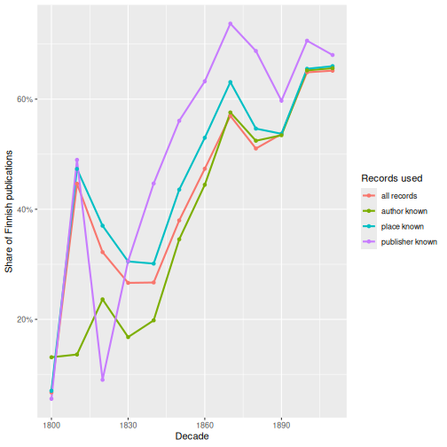

:::::::::::::::::::::::::::::::::::::: questions

- How do we check that a harmonisation did what we intended?
- How do we compare two harmonisations of the same records?
- When do data problems change the answer to a research question?

::::::::::::::::::::::::::::::::::::::::::::::::

::::::::::::::::::::::::::::::::::::: objectives

- Write validation rules as code and collect the results in a report.
- Compare our harmonisation with the Fennica project's version, field by field.
- Use disagreements to find errors in both versions.
- Show that missing values in bibliographic data are not random.
- Test how sensitive a result is to cleaning and selection decisions.

::::::::::::::::::::::::::::::::::::::::::::::::


## Why validate?

In the cleaning and harmonisation episodes we built our own harmonised variables: language,
place, publisher and author. Every step was a decision, and some decisions
will be wrong for some records. **Validation** means checking, systematically
and with code, how good the result is. We use three kinds of checks:

1. **Rules**: conditions that every value should meet ("a place name has no
   punctuation left").
2. **Comparison**: an independent harmonisation of the same records, here the
   one made by the Fennica project.
3. **Consequences**: do the remaining problems change the answer to our
   question, *how did the shift from Swedish to Finnish happen?*

We start where the harmonisation episode ended. If you don't have `records` and
`fennica_ours` in your session any more, download
[`harmonise_fennica.R`](files/harmonise_fennica.R) into your project folder
and run it:


``` r
source("harmonise_fennica.R")
```

We also load the Fennica project's harmonised data:


``` r
fennica <- read_ipc_file("data/harmonized_fennica19.feather")
```

## 1. Validation rules

A validation rule is a logical test that should be `TRUE` for every record.
It's useful to write them so that they return the records that **fail**, and
then count them. A small helper function makes a one-row report for each
rule:


``` r
check <- function(rule, failing) {
  tibble(rule = rule, n_failing = sum(failing, na.rm = TRUE))
}

check("author has no digits", grepl("[0-9]", fennica_ours$author))
```

``` output
# A tibble: 1 × 2
  rule                 n_failing
  <chr>                    <int>
1 author has no digits        16
```

We collect many rules into one report with `bind_rows()`:


``` r
validation_report <- bind_rows(
  check("id is unique",
        duplicated(fennica_ours$id)),
  check("language is a known language name",
        !is.na(fennica_ours$language) &
          !fennica_ours$language %in% language_table$name),
  check("author has no digits",
        grepl("[0-9]", fennica_ours$author)),
  check("author has no brackets",
        grepl("[][()]", fennica_ours$author)),
  check("author has no final punctuation",
        grepl("[,.;:]$", fennica_ours$author)),
  check("publisher is longer than three characters",
        nchar(fennica_ours$publisher) <= 3)
)
validation_report
```

``` output
# A tibble: 6 × 2
  rule                                      n_failing
  <chr>                                         <int>
1 id is unique                                      0
2 language is a known language name                 0
3 author has no digits                             16
4 author has no brackets                            1
5 author has no final punctuation                   0
6 publisher is longer than three characters      1057
```

Some rules pass, others don't. Let's look at the failures:


``` r
fennica_ours |>
  filter(grepl("[0-9]|[][()]", author)) |>
  count(author, sort = TRUE) |>
  head(8)
```

``` output
# A tibble: 8 × 2
  author                           n
  <chr>                        <int>
1 Daniel Henkikäsi, numero 3       5
2 Lindroth, Hjalmar,|1878-1947     2
3 1. 2. 3                          1
4 10. 11. 12                       1
5 13. 14. 15                       1
6 16. 17. 18                       1
7 4. 5. 6                          1
8 7. 8. 9                          1
```

Each failure is a different kind of problem. `Daniel Henkikäsi, numero 3`
is a pseudonym, and the number really is part of it. In
`Lindroth, Hjalmar,|1878-1947` the years of life ended up in the name field:
our `clean_author()` should keep only the part before `|`. And `1. 2. 3` is
not a name at all. When a validation rule fails, we go back to the **raw**
record:


``` r
raw |>
  filter(grepl("^[0-9]+\\. [0-9]+\\. [0-9]+", author_name)) |>
  select(id, author_name, title)
```

``` output
# A tibble: 6 × 3
  id      author_name title                           
  <chr>   <chr>       <chr>                           
1 3796398 1. 2. 3.    Ett rim efter omständigheterna /
2 3796409 4. 5. 6.    Ett rim efter omständigheterna /
3 3796415 7. 8. 9.    Ett rim efter omständigheterna /
4 3796416 10. 11. 12. Ett rim efter omständigheterna /
5 3796419 13. 14. 15. Ett rim efter omständigheterna /
6 3796421 16. 17. 18. Ett rim efter omständigheterna /
```

Six records of the same title, *Ett rim efter omständigheterna*, have
numbers in the author field: probably parts or verses that were catalogued
separately. This cannot be fixed with a rule; it is a case for a
**correction list** (a table of `id`s and corrected values), which the
pipeline applies after the automatic steps.

The short publishers are even more interesting:


``` r
fennica_ours |>
  filter(nchar(publisher) <= 3) |>
  count(publisher, sort = TRUE)
```

``` output
# A tibble: 27 × 2
   publisher     n
   <chr>     <int>
 1 SKS         800
 2 Ks          100
 3 Utg          36
 4 Owb          32
 5 Gej          30
 6 S.l          10
 7 Op            8
 8 Naz           7
 9 S.a           6
10 Sok           6
# ℹ 17 more rows
```

`SKS` is our own abbreviation, so that rule was too strict. But `S.l` and
`S.a` (*sine loco*, "without place", and *sine anno*, "without year") are not
publishers: the cataloguer put them in the wrong subfield. `Utg` (*utgivare*,
"publisher") is just the word "publisher". Validation finds problems that
were invisible in the frequency tables, and improves the rules
themselves.

::::::::::::::::::::::::::::::::::::: callout

### Hard and soft rules

Some rules must **never** fail, for example that every `id` is unique. For
them, make the script stop with an error, so that a broken export can never
silently reach the analysis. `stopifnot()` does exactly that:


``` r
stopifnot("ids must be unique" = !anyDuplicated(fennica_ours$id),
          "one row per raw record" = nrow(fennica_ours) == nrow(records))
```

Other rules are **soft**: a few failures are expected, and we report them
instead. Keep both kinds in the pipeline script, and run them every time the
data is rebuilt.

::::::::::::::::::::::::::::::::::::::::::::::::

::::::::::::::::::::::::::::::::::::: challenge

## Challenge 1: How much did the synonym table miss?

Write a rule that counts the records where a place **was** recorded in the
raw data, but our harmonised `place` is `NA`. (Hint: use
`clean_place_text(coalesce(records$place_260, records$place_264))`, and
remember that we deliberately removed the digitised copies from Mikkeli.)
What are the most common unmatched values? Which of them should be added to
the synonym table, and which should stay `NA`?

:::::::::::::::::::::::: solution


``` r
digitised_copy <- is_blank(records$place_260) &
  grepl("Mikkeli", records$place_264) &
  grepl("verkkoaineisto", records$extent)

place_text <- clean_place_text(coalesce(records$place_260,
                                        ifelse(digitised_copy, NA, records$place_264)))
unmatched <- !is.na(place_text) & is.na(fennica_ours$place)

check("recorded place was not matched", unmatched)
```

``` output
# A tibble: 1 × 2
  rule                           n_failing
  <chr>                              <int>
1 recorded place was not matched      4892
```

``` r
head(sort(table(place_text[unmatched]), decreasing = TRUE), 12)
```

``` output

kustannuspaikka tuntematon                       s.l. 
                      1966                        692 
              s.-peterburg            hancock (mich.) 
                       219                        188 
              gel'singfors          fitchburg (mass.) 
                       117                        112 
                kjøbenhavn              s.-peterburgʺ 
                        75                         62 
                      aboæ            brooklyn (n.y.) 
                        59                         53 
            st. petersburg             duluth (minn.) 
                        52                         51 
```

"Place unknown" (*kustannuspaikka tuntematon*, *s.l.*) should stay `NA`.
Russian forms of St Petersburg and Helsinki (`s.-peterburg`,
`gel'singfors`), Danish Copenhagen (`kjøbenhavn`, `københavn`), the Latin
`aboæ` (Turku), and the Finnish emigrant presses in the United States should
be added to the synonym table.

:::::::::::::::::::::::::::::::::
::::::::::::::::::::::::::::::::::::::::::::::::

## 2. Comparing two harmonisations

The Fennica project harmonised the same records with its own code. The two
versions were made independently, so where they **agree** we can be more
confident, and where they **disagree** at least one of them is wrong. We
join the two by `id`:


``` r
comparison <- fennica_ours |>
  left_join(
    fennica |>
      select(id,
             their_language = language_original_primary,
             their_place = publication_place,
             their_publisher = publisher,
             their_author = author_name_100,
             year = publication_year,
             decade = publication_decade),
    by = "id")
```

A function for the share of records where both versions have a value and the
values are the same (ignoring upper and lower case):


``` r
agreement <- function(ours, theirs) {
  mean(tolower(ours) == tolower(theirs), na.rm = TRUE)
}
```

### Language


``` r
agreement(comparison$language, comparison$their_language)
```

``` output
[1] 1
```

``` r
comparison |>
  count(ours_missing = is.na(language), theirs_missing = is.na(their_language))
```

``` output
# A tibble: 4 × 3
  ours_missing theirs_missing     n
  <lgl>        <lgl>          <int>
1 FALSE        FALSE          71281
2 FALSE        TRUE             728
3 TRUE         FALSE             15
4 TRUE         TRUE             602
```

Where both have a value they agree completely. But we have a language for
728
records where the project version has none: those are the records without
field 041, which we filled from field 008.

### Place and publisher


``` r
agreement(comparison$place, comparison$their_place)
```

``` output
[1] 0.01724056
```

``` r
agreement(comparison$publisher, comparison$their_publisher)
```

``` output
[1] 9.325531e-05
```

Almost no agreement at all! Something must be very different. Let's look at
a few records side by side:


``` r
comparison |>
  select(place, their_place, publisher, their_publisher) |>
  filter(!is.na(place), !is.na(publisher)) |>
  head(5)
```

``` output
# A tibble: 5 × 4
  place    their_place                  publisher                their_publisher
  <chr>    <chr>                        <chr>                    <chr>          
1 Vyborg   F cederwaller                A. F. Cederwaller        wiipurissa     
2 Helsinki Jim östling                  G. Jim Östling           helsingfors    
3 Helsinki Sällskapet finlands geografi Sällskapet För Finlands… helsingfors    
4 Turku    <NA>                         Frenckell                turku          
5 Turku    W lillja                     J. W. Lillja             åbo            
```

The project's `publication_place` column contains publishers, and its
`publisher` column contains places: the two columns were **swapped** during
harmonisation. In the raw data (fields 260a and 260b) they are correct.
Comparing the other way round:


``` r
agreement(comparison$place, comparison$their_publisher)
```

``` output
[1] 0.6256056
```

``` r
agreement(comparison$publisher, comparison$their_place)
```

``` output
[1] 0.5564043
```

Better, but still far from complete. What are the most common disagreements
in place?


``` r
comparison |>
  filter(tolower(place) != tolower(their_publisher)) |>
  count(place, their_place = their_publisher, sort = TRUE) |>
  head(8)
```

``` output
# A tibble: 8 × 3
  place    their_place     n
  <chr>    <chr>       <int>
1 Helsinki helsingfors 11549
2 Turku    åbo           943
3 Vyborg   viipuri       692
4 Turku    aboae         623
5 Helsinki helsingissä   516
6 Porvoo   borgå         470
7 Vaasa    vasa          241
8 Vyborg   wiipuri       189
```

The project's version keeps the **language of the name**: Helsingfors and
Helsinki, Åbo and Turku are separate values. That is not wrong, but it is a
different decision, and it matters a lot, as we will see below.

::::::::::::::::::::::::::::::::::::: challenge

## Challenge 2: A publisher called Turku

The project's publisher column (remember: `their_place` after the swap)
contains the value `Turku` for
579 records. Turku is
a town, not a publisher. Find out which publishers in **our** version these
records have. Is it our error or theirs?

:::::::::::::::::::::::: solution


``` r
comparison |>
  filter(their_place == "Turku") |>
  count(publisher, sort = TRUE) |>
  head(8)
```

``` output
# A tibble: 8 × 2
  publisher                                                       n
  <chr>                                                       <int>
1 Svenska Litteratursällskapet I Finland                         92
2 Turistföreningen I Finland                                     18
3 Föreningen För Arbetareskydd Och Socialförsäkring I Finland    17
4 Lutherska Evangeliföreningen I Finland                         17
5 Åbo Stad                                                       15
6 Åbo Tidning                                                    11
7 Fiskeriföreningen I Finland                                    10
8 Svenska Litteratursälskapet I Finland                          10
```

The raw publishers are societies with names like *Svenska
Litteratursällskapet i Finland*, and a few with *Åbo* in their name. A rule
in the project's harmonisation turned them into the town name Turku. It is an
error in the project version, which we found only because we had an
independent version to compare with.

:::::::::::::::::::::::::::::::::
::::::::::::::::::::::::::::::::::::::::::::::::

### Author


``` r
agreement(comparison$author, comparison$their_author)
```

``` output
[1] 0.8399559
```

``` r
comparison |>
  filter(tolower(author) != tolower(their_author)) |>
  count(author, their_author, sort = TRUE) |>
  head(6)
```

``` output
# A tibble: 6 × 3
  author                their_author               n
  <chr>                 <chr>                  <int>
1 Setälä, E. N          Setälä, E N              100
2 Reuter, O. M          Reuter, O M               91
3 Leinberg, K. G        Leinberg, K G             81
4 Thomas Ragvaldinpoika Ragvaldinpoika, Thomas    78
5 Tavaststjerna, K. A   Tavaststjerna, K A        74
6 Tigerstedt, K. K      Tigerstedt, K K           74
```

Most differences are a matter of style: the project's
[`polish_author()`](https://github.com/fennicahub/fennica/blob/master/R/polish_author.R)
removes all full stops from initials (`E N` instead of `E. N`). But look at
*Thomas Ragvaldinpoika*: a patronymic (*-poika* = "son of"), correctly
catalogued with the given name first, which the project version reverses
into `Ragvaldinpoika, Thomas`, as if it were a surname. Rules written for modern names do not fit
every name.

## 3. Missing values are not random

So far we have asked whether the values are **right**. Just as important is
which values are **missing**. Compare Finnish and Swedish publications:


``` r
comparison |>
  filter(language %in% c("Finnish", "Swedish")) |>
  group_by(language) |>
  summarise(records = n(),
            no_place = mean(is.na(place)),
            no_publisher = mean(is.na(publisher)),
            no_author = mean(is_blank(author)))
```

``` output
# A tibble: 2 × 5
  language records no_place no_publisher no_author
  <chr>      <int>    <dbl>        <dbl>     <dbl>
1 Finnish    40581    0.157        0.302     0.385
2 Swedish    23352    0.211        0.520     0.422
```

A Swedish publication is much more likely than a Finnish one to have no
publisher and no place. The missing values are **not random**: whether a
value is missing depends on the very thing we want to study. Any analysis
that silently drops the incomplete records will be biased.

## 4. Does it change the answer?

The final and most important validation question is: **do these problems
change our conclusions?** We calculate the share of Finnish publications per
decade on four different subsets of the data, the kind of subsets that
appear automatically when an analysis uses one more variable:


``` r
finnish_share <- comparison |>
  filter(!is.na(decade), !is.na(language)) |>
  group_by(decade) |>
  summarise(
    `all records`          = mean(language == "Finnish"),
    `place known`          = mean(language[!is.na(place)] == "Finnish"),
    `publisher known`      = mean(language[!is.na(publisher)] == "Finnish"),
    `author known`         = mean(language[!is_blank(author)] == "Finnish")
  )

finnish_share
```

``` output
# A tibble: 12 × 5
   decade `all records` `place known` `publisher known` `author known`
    <dbl>         <dbl>         <dbl>             <dbl>          <dbl>
 1   1800        0.0671        0.0701            0.0556          0.131
 2   1810        0.446         0.473             0.490           0.136
 3   1820        0.322         0.370             0.0901          0.236
 4   1830        0.266         0.305             0.306           0.168
 5   1840        0.267         0.301             0.447           0.198
 6   1850        0.380         0.436             0.561           0.345
 7   1860        0.474         0.530             0.632           0.444
 8   1870        0.570         0.631             0.737           0.576
 9   1880        0.510         0.547             0.688           0.524
10   1890        0.537         0.537             0.597           0.534
11   1900        0.649         0.655             0.706           0.652
12   1910        0.652         0.660             0.680           0.656
```

`language[!is.na(place)]` takes the languages only of the records where the
place is known. A plot makes the differences easier to see:


``` r
finnish_share |>
  pivot_longer(-decade, names_to = "subset", values_to = "share") |>
  ggplot(aes(x = decade, y = share, colour = subset)) +
  geom_line(linewidth = 1) +
  geom_point() +
  scale_y_continuous(labels = scales::percent) +
  labs(x = "Decade", y = "Share of Finnish publications", colour = "Records used")
```



The overall story is the same in every version: Finnish rises from almost
nothing to about two thirds of all publications. But the **size** and the
**timing** of the shift depend on the subset. Among records with a known
publisher, Finnish already passes 50% in the 1850s; among all records, only
in the 1870s. In the early decades, where there are few records, the lines
jump around wildly. That uncertainty is what the next parts of this course
are about.

(The high value for the 1810s is a puzzle of its own. It comes from the
publication dates, which we examine in a later episode.)

::::::::::::::::::::::::::::::::::::: challenge

## Challenge 3: The language of a place name

Use `records` and `fennica_ours` to calculate the share of Finnish
publications among the records whose raw field 260 says exactly
`Helsinki :` and among those that say `Helsingfors :`. What does this tell
you about using the **raw** place name in an analysis of language? And what
does it tell you about the project version, which keeps Helsinki and
Helsingfors apart?

:::::::::::::::::::::::: solution


``` r
tibble(place_260 = records$place_260, language = fennica_ours$language) |>
  filter(place_260 %in% c("Helsinki :", "Helsingfors :")) |>
  group_by(place_260) |>
  summarise(records = n(), finnish = mean(language == "Finnish", na.rm = TRUE))
```

``` output
# A tibble: 2 × 3
  place_260     records finnish
  <chr>           <int>   <dbl>
1 Helsingfors :   11025  0.0387
2 Helsinki :      13566  0.952 
```

Almost all books with *Helsinki* are in Finnish, and almost all books with
*Helsingfors* in Swedish: the place name is copied from the title page, so it
is written **in the language of the book**. In the project version, "Helsinki"
and "Helsingfors" therefore look like two different towns with opposite
languages. A model that tried to "explain" the language with this place
variable would find a perfect but meaningless relationship, because the
variable is partly the outcome itself. Harmonising the place names is
necessary before place can be used to study language.

:::::::::::::::::::::::::::::::::
::::::::::::::::::::::::::::::::::::::::::::::::

## Validation as part of the pipeline

Validation is not a one-off check but part of the workflow:

1. **Profile** the raw data.
2. **Harmonise** with functions and lookup tables.
3. **Validate** with rules, comparisons and sensitivity checks.
4. Fix the rules or the tables, and **rerun** everything from the raw data.

Save the validation report together with the data, so that anyone using the
data can see what was checked:


``` r
write.csv(validation_report, "data/validation_report.csv", row.names = FALSE)
```

::::::::::::::::::::::::::::::::::::: keypoints

- Validation rules are logical tests written as code; count the records that fail and inspect them in the raw data.
- Use `stopifnot()` for rules that must never fail, and a report for rules that may.
- Two independent harmonisations of the same records are a powerful check: disagreements reveal errors in both.
- The Fennica project's harmonised data has swapped place and publisher columns and keeps language-specific place names.
- Missing values in bibliographic data are not random: Swedish publications lack a publisher or place more often than Finnish ones.
- Always test whether cleaning and selection decisions change the answer to your research question.

::::::::::::::::::::::::::::::::::::::::::::::::
