:::::::::::::::::::::::::::::::::::::: questions

- How do I make plots of my data in R?
- Which kind of plot suits which kind of question?
- How do I make a plot ready to share?

::::::::::::::::::::::::::::::::::::::::::::::::

::::::::::::::::::::::::::::::::::::: objectives

- Explain the building blocks of a ggplot: data, aesthetics and geoms.
- Create bar charts, line charts, histograms and box plots.
- Map variables to colour and split plots into panels with facets.
- Add labels, change the theme and save a plot to a file.

::::::::::::::::::::::::::::::::::::::::::::::::


## The grammar of graphics

**ggplot2** builds plots from layers. Every plot needs three things:

1. **data**: a data frame,
2. **aesthetics** (`aes()`): which columns are mapped to the x and y axes,
   colour, size and so on,
3. **geoms**: the type of mark used to draw the data (points, lines, bars…).

Layers are added with `+`.


``` r
library(ggplot2)
```

(As before, start with `fennica_clean` loaded; see the previous episode.)

## Bar charts: comparing categories

`geom_bar()` counts the rows in each category for us:


``` r
ggplot(data = fennica_clean, mapping = aes(x = type)) +
  geom_bar()
```

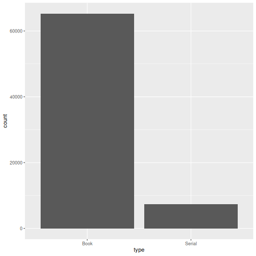

When we have already counted, we use `geom_col()` and give the y values
ourselves. Here are the ten most common places of publication:


``` r
top_places <- fennica_clean |>
  filter(!is.na(place)) |>
  count(place, sort = TRUE) |>
  head(10)

ggplot(top_places, aes(x = n, y = reorder(place, n))) +
  geom_col()
```

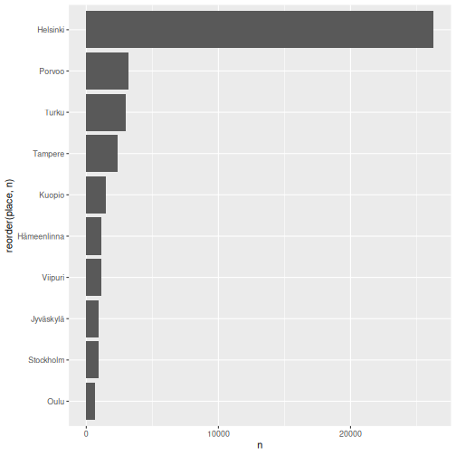

`reorder(place, n)` sorts the bars by size, which makes the chart much easier
to read. Putting the categories on the y axis keeps long labels readable.

## Line charts: change over time

How did the number of publications develop year by year?


``` r
per_year <- fennica_clean |>
  count(year)

ggplot(per_year, aes(x = year, y = n)) +
  geom_line()
```

``` warning
Warning: Removed 1 row containing missing values or values outside the scale range
(`geom_line()`).
```

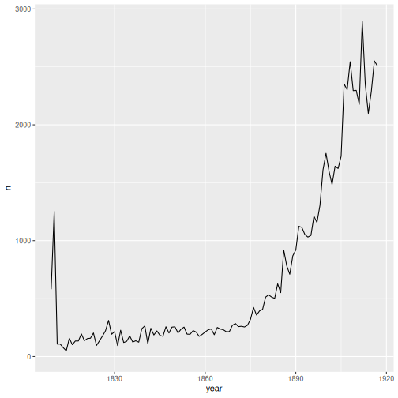

## Colour: adding a third variable

By mapping `language` to `colour`, we get one line per language:


``` r
per_year_language <- fennica_clean |>
  filter(language %in% c("Finnish", "Swedish", "Latin", "German")) |>
  count(year, language)

ggplot(per_year_language, aes(x = year, y = n, colour = language)) +
  geom_line()
```

``` warning
Warning: Removed 2 rows containing missing values or values outside the scale range
(`geom_line()`).
```

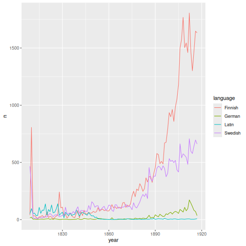

::::::::::::::::::::::::::::::::::::: callout

### Question every spike

What happened in 1809 and 1810? If we look at the original data, the column
`publication_status` shows that 1,072 of the 1,186 records dated 1810 have a
*"Questionable date"*. Most of them come from a digitised collection whose
items could only be roughly dated. The spike says more about cataloguing than
about publishing history. Plots are an excellent way to discover such problems.

::::::::::::::::::::::::::::::::::::::::::::::::

::::::::::::::::::::::::::::::::::::: callout

### Mapping versus setting

Inside `aes()`, an aesthetic is *mapped* to a column: the colour changes with
the data. Outside `aes()`, it is *set* to a fixed value for all marks, for
example `geom_line(colour = "darkblue", linewidth = 1)`.

::::::::::::::::::::::::::::::::::::::::::::::::

## Proportions: stacked bars

To show how the *share* of each language changed, we can use stacked bars with
`position = "fill"`, which scales every bar to 100%:


``` r
fennica_clean |>
  mutate(language_group = if_else(
    language %in% c("Finnish", "Swedish", "Latin", "German"),
    language, "Other")) |>
  ggplot(aes(x = decade, fill = language_group)) +
  geom_bar(position = "fill")
```

``` warning
Warning: Removed 12 rows containing non-finite outside the scale range
(`stat_count()`).
```

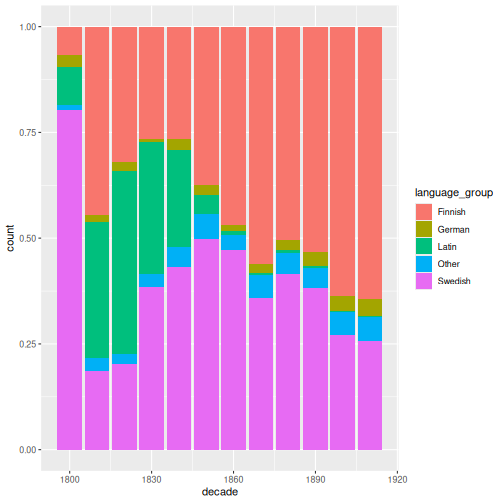

Notice that we can pipe data straight into `ggplot()`.

## Distributions: histograms and box plots

A **histogram** shows how values of a single numeric variable are distributed.
How long are titles, in words?


``` r
ggplot(fennica_clean, aes(x = title_words)) +
  geom_histogram(binwidth = 1)
```

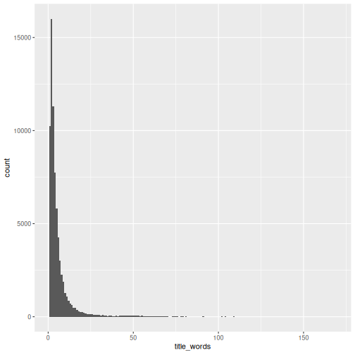

The distribution is very **skewed**: most titles are short, but a few are
extremely long. A logarithmic scale spreads out the values:


``` r
ggplot(fennica_clean, aes(x = title_words)) +
  geom_histogram(bins = 30) +
  scale_x_log10()
```

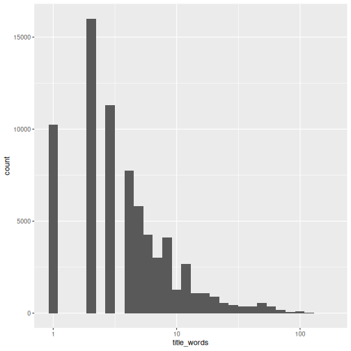

A **box plot** compares distributions between groups. The thick line is the
median, the box covers the middle 50% of the values and points are unusually
large values:


``` r
fennica_clean |>
  filter(language %in% c("Finnish", "Swedish", "Latin", "German")) |>
  ggplot(aes(x = language, y = title_words)) +
  geom_boxplot() +
  scale_y_log10()
```

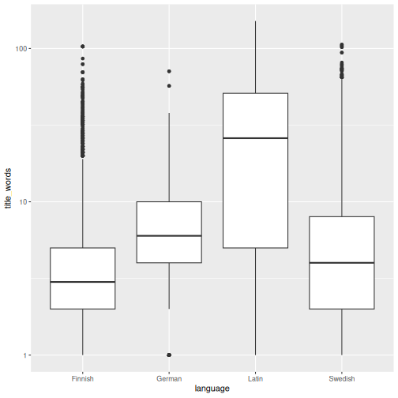

## Facets: small multiples

`facet_wrap()` splits a plot into panels, one per value of a variable:


``` r
fennica_clean |>
  filter(!is.na(genre)) |>
  count(decade, genre) |>
  ggplot(aes(x = decade, y = n)) +
  geom_line() +
  facet_wrap(~ genre, scales = "free_y")
```

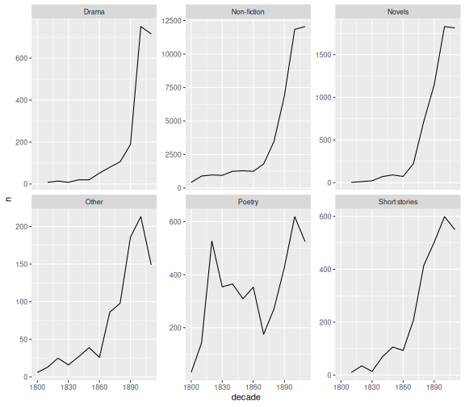

`scales = "free_y"` gives each panel its own y axis, so that small genres are
not flattened by large ones. But beware: panels can no longer be compared by
height!

## Making a plot ready to share

`labs()` adds titles and axis labels, and themes change the overall look:


``` r
language_plot <- per_year_language |>
  filter(language %in% c("Finnish", "Swedish")) |>
  ggplot(aes(x = year, y = n, colour = language)) +
  geom_line(linewidth = 0.8) +
  labs(
    title = "The rise of Finnish-language publishing",
    subtitle = "Publications per year in the Fennica bibliography, 1809–1917",
    x = "Year of publication",
    y = "Number of records",
    colour = "Language"
  ) +
  theme_minimal()

language_plot
```

``` warning
Warning: Removed 2 rows containing missing values or values outside the scale range
(`geom_line()`).
```

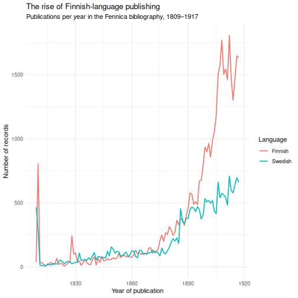

Save a plot to a file with `ggsave()`. The file type is taken from the file
name:


``` r
ggsave("finnish_vs_swedish.png", language_plot, width = 8, height = 5, dpi = 300)
```

::::::::::::::::::::::::::::::::::::: challenge

## Challenge 1: Authors' life spans

Make a histogram of `author_death - author_birth` (the authors' age at death)
for records with known dates. Use `distinct(author, .keep_all = TRUE)` first so
that each author is counted only once. Add axis labels.

:::::::::::::::::::::::: solution


``` r
fennica_clean |>
  filter(!is.na(author_birth), !is.na(author_death)) |>
  distinct(author, .keep_all = TRUE) |>
  mutate(age_at_death = author_death - author_birth) |>
  ggplot(aes(x = age_at_death)) +
  geom_histogram(binwidth = 5) +
  labs(x = "Age at death (years)", y = "Number of authors")
```

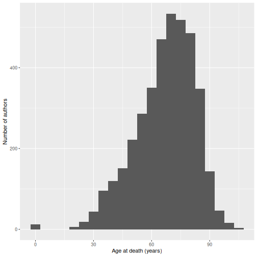

Most authors died in their sixties or seventies. The small bar at zero is a
data error in the harmonised author dates: when the raw record
only says *syntynyt 1875* ("born 1875"), the harmonisation set both the birth
and the death year to 1875.

:::::::::::::::::::::::::::::::::
::::::::::::::::::::::::::::::::::::::::::::::::

::::::::::::::::::::::::::::::::::::: challenge

## Challenge 2: Fiction over time

Make a line chart showing the number of **novels**, **poetry** and **drama**
records per decade, with one coloured line per genre. Add a title.

:::::::::::::::::::::::: solution


``` r
fennica_clean |>
  filter(genre %in% c("Novels", "Poetry", "Drama")) |>
  count(decade, genre) |>
  ggplot(aes(x = decade, y = n, colour = genre)) +
  geom_line() +
  geom_point() +
  labs(title = "Fiction in Fennica by decade",
       x = "Decade", y = "Number of records", colour = "Genre") +
  theme_minimal()
```

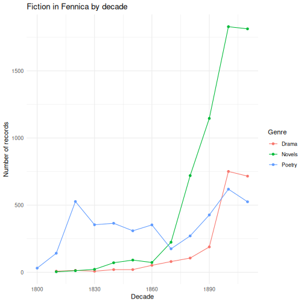

:::::::::::::::::::::::::::::::::
::::::::::::::::::::::::::::::::::::::::::::::::

::::::::::::::::::::::::::::::::::::: challenge

## Challenge 3: Improve a plot

The plot below is hard to read. List at least three things that could be
improved, then improve it.

```r
fennica_clean |>
  count(language) |>
  ggplot(aes(x = language, y = n)) +
  geom_col()
```

:::::::::::::::::::::::: solution

Problems: there are many tiny languages, the labels overlap, the bars are not
sorted and the axes have no clear labels. One improvement:


``` r
fennica_clean |>
  count(language, sort = TRUE) |>
  head(10) |>
  ggplot(aes(x = n, y = reorder(language, n))) +
  geom_col() +
  labs(x = "Number of records", y = NULL,
       title = "The ten most common languages in Fennica, 1809–1917") +
  theme_minimal()
```

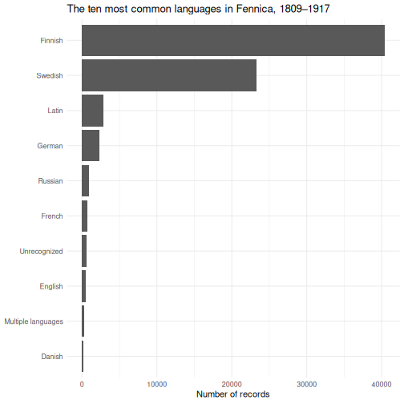

:::::::::::::::::::::::::::::::::
::::::::::::::::::::::::::::::::::::::::::::::::

::::::::::::::::::::::::::::::::::::: keypoints

- A ggplot is built from data, aesthetic mappings (`aes()`) and geoms, joined with `+`.
- Bar charts compare categories, line charts show change, histograms and box plots show distributions.
- Map a variable to `colour` or `fill`, or use `facet_wrap()`, to show more variables.
- Sort categories, label axes and choose sensible scales to make plots readable.
- Save plots with `ggsave()`.

::::::::::::::::::::::::::::::::::::::::::::::::
